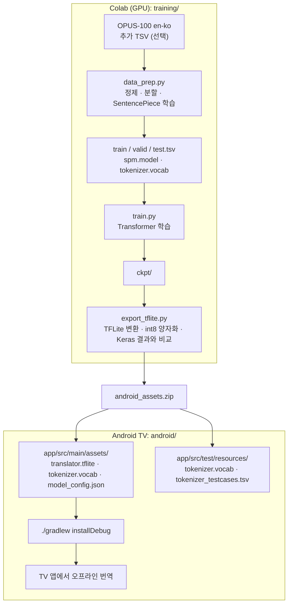
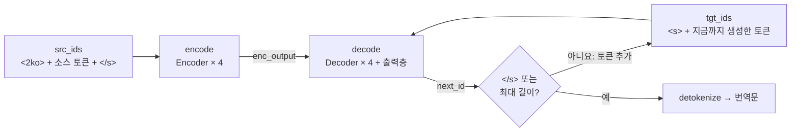
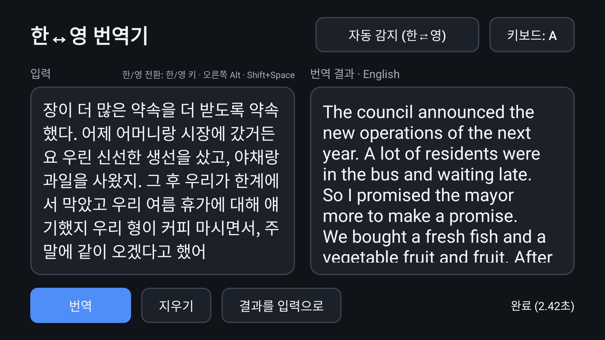
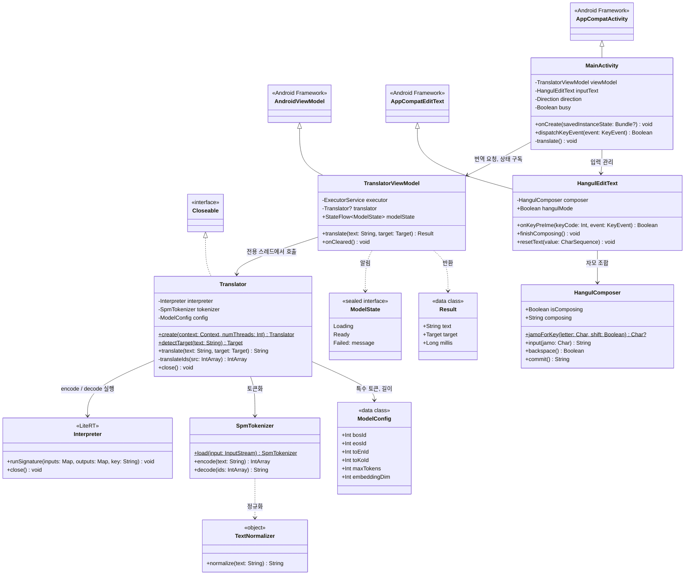
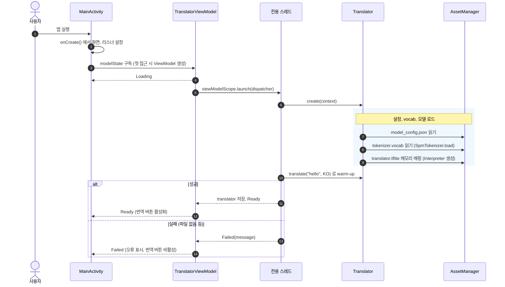
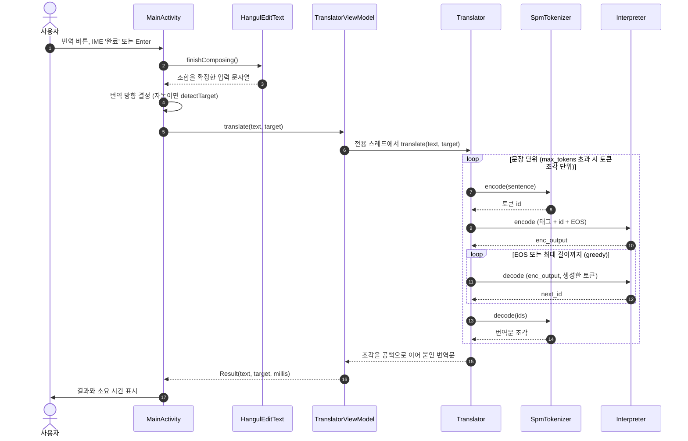
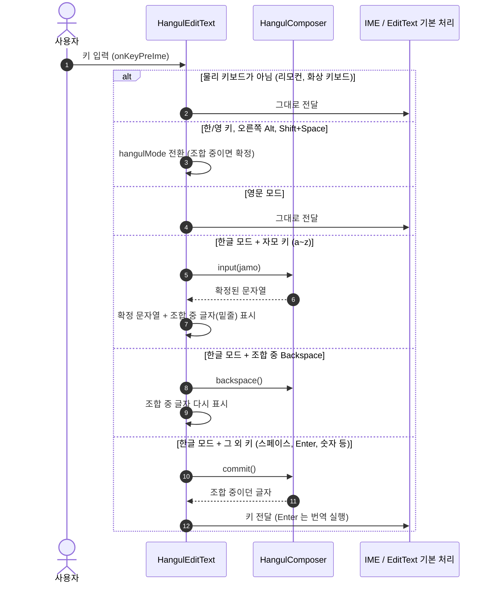
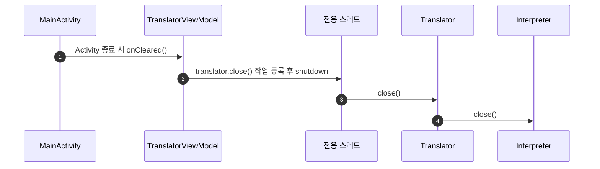

# Android TV 한↔영 번역기

`coursera_transformer_jnb/C5_W4_A1_Transformer_Subclass_v1.ipynb` 에서 구현한 Transformer 로
한↔영 **양방향** 번역 모델을 학습하고, Android TV 앱에서 기기 내(오프라인) 추론으로 실행한다.

```
coursera_transformer_jnb/  원본 Coursera 노트북 (수정하지 않음)
training/                  학습 · 변환 파이프라인 (Python)
android/                   Android TV 앱 (Kotlin, LiteRT)
```

## 전체 흐름

1. `training/` 폴더를 Google Drive 에 올리고 `training/KoEn_Translator_Colab.ipynb` 를 Colab(GPU)에서 실행한다.
2. 마지막 셀에서 내려받은 `android_assets.zip` 의 파일을 복사한다.
   - `translator.tflite`, `tokenizer.vocab`, `model_config.json` → `android/app/src/main/assets/`
   - `tokenizer.vocab`, `tokenizer_testcases.tsv` → `android/app/src/test/resources/`
3. `android/` 를 Android Studio 로 열어 빌드한 뒤 TV 에 설치한다 (`./gradlew installDebug`).



## 모델 설계

- **단일 모델 + 방향 태그**: 소스 앞에 목표 언어 태그를 붙여 한 모델로 양방향 번역을 한다.
  - 영→한: `[<2ko>] + en + [</s>]` → `[<s>] + ko + [</s>]`
  - 한→영: `[<2en>] + ko + [</s>]` → `[<s>] + en + [</s>]`
- **Transformer**: 노트북의 `Transformer` 클래스를 그대로 쓴다(`training/transformer.py`, 단위 테스트 8개 통과).
  4 layers, d_model 256, 4 heads, FFN 1024, 파라미터 약 2,900만 개 (`training/config.py`).
- **토크나이저**: 한·영 공유 SentencePiece unigram 16k, `byte_fallback` 으로 드문 한글 음절(인명 등)도 표현한다.
- **데이터**: OPUS-100 en-ko (100만 쌍, 자막 위주) → 정제 후 약 82만 쌍 × 양방향.
  AI Hub 같은 코퍼스는 `en<TAB>ko` TSV 로 만들어 `data_prep.main(..., extra_tsv=[...])` 에 넘긴다.
- **TFLite**: `encode` / `decode` 두 signature, 가변 길이, int8 동적 양자화 (약 29MB).
  `decode` 는 마지막 위치의 다음 토큰 id 만 돌려주고, 앱이 greedy decoding 을 반복한다.

영→한 번역의 추론 과정 (한→영은 태그만 `<2en>` 으로 바뀐다):



## Android 앱



- 리모컨: D-pad 로 이동하고, 입력창에서 가운데 버튼을 누르면 화상 키보드가 열린다. '완료'를 누르면 번역한다.
- 블루투스/USB 키보드: Enter 로 번역한다. **앱 내장 두벌식 한글 조합기**를 쓰며, 한/영 키 · 오른쪽 Alt · Shift+Space 또는 화면의 `키보드: 한/A` 버튼으로 전환한다.
  (한글 조합을 지원하지 않는 TV IME 가 많아서 앱이 직접 조합한다)
- 번역 방향: 자동 감지(한글이 있으면 한→영) / 한→영 / 영→한
- 긴 입력은 문장 단위(. ! ? 줄바꿈)로 나눠서 번역한다.

### 주요 구성 요소

| 구성 요소 | 역할 |
|---|---|
| `MainActivity` | 화면, 버튼, 번역 방향을 관리하고 번역을 요청한다. |
| `TranslatorViewModel` | 모델 로딩과 번역을 전용 스레드 하나에서 수행하고 모델 상태를 알린다. |
| `Translator` | 문장 분리, 토큰화, TFLite 추론(encode + greedy decode)을 수행한다. |
| `SpmTokenizer` / `TextNormalizer` | SentencePiece unigram 토크나이저의 Kotlin 구현과 입력 정규화. |
| `HangulEditText` | 물리 키보드 입력을 IME 보다 먼저 받아 한글 조합으로 보내는 입력창. |
| `HangulComposer` | 두벌식 자모를 음절로 조합하는 오토마타. |

### 클래스 다이어그램



### 시퀀스 다이어그램

#### 앱 시작과 모델 로딩



#### 번역



#### 물리 키보드 한글 입력



#### 종료



## 검증한 내용

| 항목 | 결과 |
|---|---|
| 노트북 단위 테스트 (`transformer.py`) | 8/8 통과 |
| Python 레퍼런스 토크나이저 vs sentencepiece | 47,549 문장 ID/디코딩 완전 일치 |
| Kotlin 토크나이저 vs sentencepiece (`SpmTokenizerTest`) | 606 케이스 일치 |
| 두벌식 조합기 (`HangulComposerTest`) | 6개 테스트 통과 |
| TFLite(float32) vs Keras greedy 결과 | 20/20 토큰 단위 일치 |
| 에뮬레이터 실행 | 모델 로딩, 번역, 화상 키보드 '완료', D-pad 포커스 동작 확인 |

위 표의 TFLite 비교와 에뮬레이터 실행은 CPU 에서 200 step 만 학습한 모델로 확인했다.

이후 Colab 에서 80,000 step 학습한 모델을 실기기(MAU4800DG)에 설치해 다음을 확인했다.

- 리모컨 조작과 화상 키보드로 한↔영 번역이 동작한다. 앱 메모리는 PSS 약 120MB 이다.
- 블루투스 키보드(K380)로 두벌식 입력, 한/영 전환, Enter 번역이 동작한다.
- 긴 문장에서도 크래시나 시간 문제는 없다.

번역 품질에는 다음 문제가 남아 있다.

- 짧은 문장에도 오역이 있다 (예: "for two nights" → "두밤중에").
- 번역 결과 앞에 "-" 가 붙는 경우가 있다.
- 긴 문장은 내용 누락과 오역이 심하다.

## 데이터를 추가해 재학습하기

아직 진행하지 않았다. 현재 모델은 OPUS-100 만으로 80,000 step 학습했고(약 4시간, valid loss 3.13, valid acc 0.41),
train loss 가 평탄해져서 품질을 높이려면 step 을 늘리기보다 데이터를 추가해야 한다.

| 후보 | 규모 | 내용 | 확인할 점 |
|---|---|---|---|
| [AI Hub 한국어-영어 번역 말뭉치](https://aihub.or.kr/aidata/87) (권장) | 160만 쌍 (뉴스 80만 쌍 포함) | 뉴스·공공 어휘 보강에 가장 적합 | 직접 신청. 신청 자격과 이용 범위는 약관 확인 필요 |
| [lemon-mint/korean_english_parallel_wiki_augmented_v1](https://huggingface.co/datasets/lemon-mint/korean_english_parallel_wiki_augmented_v1) | 약 50만 쌍 | 위키백과 기반 | CC-BY-SA 3.0 으로 표기. 품질은 샘플 확인 필요 |

Hugging Face 에 올라온 AI Hub 데이터의 개인 사본은 라이선스 문제가 있을 수 있어 쓰지 않는다.

1. 코퍼스를 `en<TAB>ko` TSV 로 만들어 Drive 에 올린다.
2. 기존 결과를 덮어쓰지 않도록 노트북의 `WORK_DIR` 을 새 경로로 바꾼다. vocab 이 새로 만들어지므로 기존 checkpoint 는 이어 쓸 수 없다.
3. 노트북의 `data_prep.main(WORK_DIR, extra_tsv=[...])` 에 TSV 경로를 넣는다.
4. 데이터 양에 맞춰 `train_steps` 를 늘려 학습한다. GPU 기준 80,000 step 에 약 3.8시간이 걸리며, 학습 시간은 `WORK_DIR/train_time.log` 에 기록된다.
5. 변환한 assets 를 앱에 복사한다. valid 데이터는 자막 위주라 뉴스 번역 개선은 valid loss 로 알 수 없으므로, 고정 시험 문장으로 기존 모델과 비교한다.

## 참고 / 한계

- OPUS-100 은 영화 자막 중심이라 구어체에 강하고, 뉴스·기술 문서에는 약하다. 품질을 높이려면 AI Hub 한영 코퍼스를 추가하는 것이 가장 효과적이다.
- 노트북 구현은 `MultiHeadAttention(key_dim=embedding_dim)` 으로 헤드당 차원이 d_model 이라 일반적인 구현보다 attention 연산량이 4배 크다. 노트북 코드를 그대로 쓰기 위해 바꾸지 않았다.
- 학습 환경을 바꿀 때는 TensorFlow 와 Keras 버전을 짝에 맞게 써야 한다 (예: TF 2.16 ↔ Keras 3.3).
